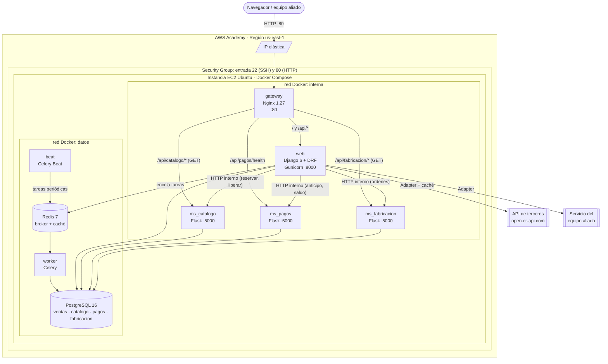
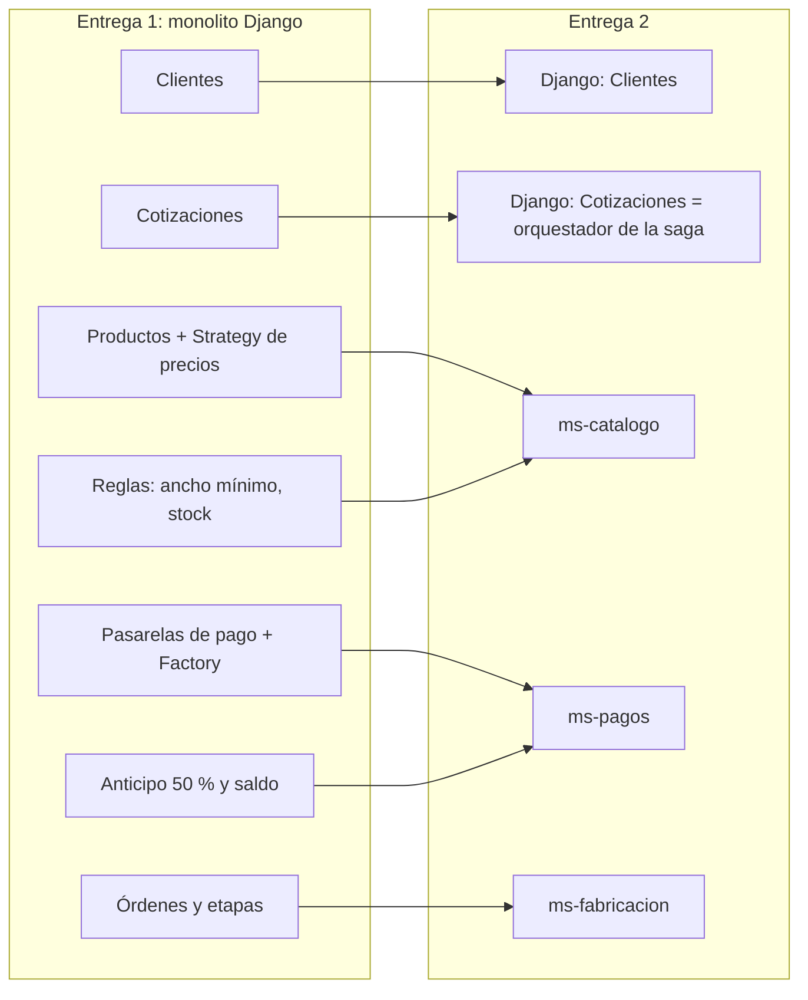
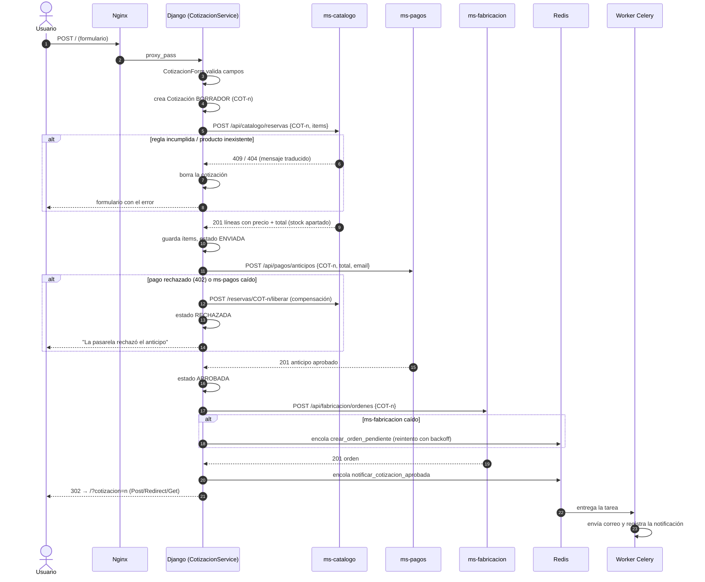
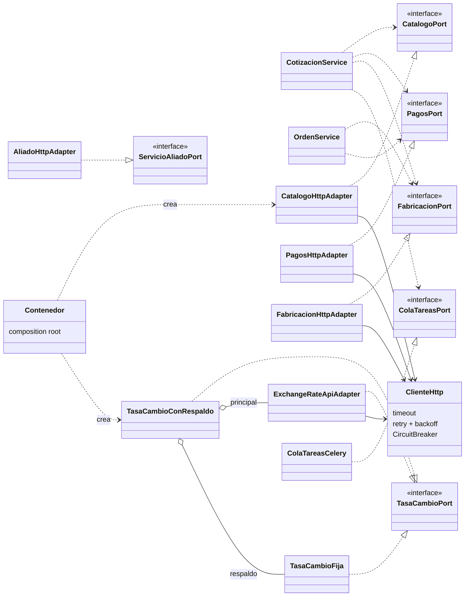
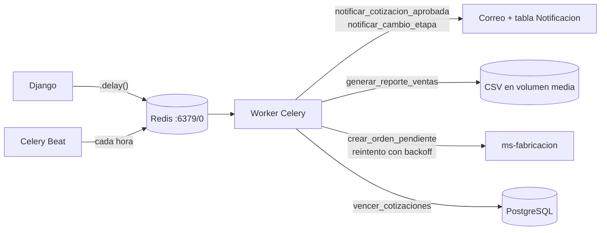

# Arquitectura — Entrega 2: microservicios, integración y resiliencia

> Los diagramas están en Mermaid: GitHub los dibuja directamente. Se pueden
> copiar tal cual a la Wiki del repositorio.

## 1. Vista de despliegue (AWS Academy)

Solo **Nginx** publica un puerto. La red `datos` aísla PostgreSQL y Redis: el
gateway no puede llegar a ellos. Cada microservicio tiene **su propia base de
datos y su propio usuario** (Database per Service), creados por
`docker/postgres/01-crear-bases.sh`.

## 2. Strangler Pattern: qué se migró

| Lógica / dato | Antes (monolito) | Ahora |
|---|---|---|
| Catálogo y stock | `models.Producto` + subclases | **ms-catalogo** (`productos`) |
| Strategy de precios | `ventas/domain/precios.py` | **ms-catalogo** `app/dominio/precios.py` |
| Reglas de la cotización (Builder) | `ventas/domain/builders.py` | **ms-catalogo** `app/dominio/cotizador.py` |
| Reserva y liberación de stock | — (descontaba directo) | **ms-catalogo** `/reservas` (nuevo, con compensación) |
| Pasarelas real/mock + Factory | `ventas/infra/` | **ms-pagos** `app/infra/pasarelas.py` |
| Anticipo 50 % y saldo | `ventas/services.py` | **ms-pagos** `app/dominio/reglas.py` |
| Registro de pagos | `models.Pago` | **ms-pagos** (`cobros`) |
| Órdenes y secuencia de etapas | `models.OrdenFabricacion`, `reglas.py` | **ms-fabricacion** (`ordenes`, `eventos_orden`) |
| Clientes, cotizaciones | Django | Django (orquestador) |
| Notificaciones, reportes, vencimientos | — | Django + **Celery** (segundo plano) |

De las 7 responsabilidades de negocio que tenía el monolito, **5 viven ahora en
microservicios independientes** (≈ 71 %). Django conserva clientes y la
orquestación de la cotización, más la interfaz web.

## 3. Saga de "crear cotización" (orquestada, con compensación)

Todos los endpoints de escritura de los microservicios son **idempotentes**
por referencia (`COT-n`), por eso el cliente HTTP puede reintentar sin cobrar
dos veces ni duplicar órdenes.

## 4. Puertos y adaptadores (Inversión de Dependencias)

* **Puertos**: `ventas/domain/puertos.py` (abstracciones) y `ventas/domain/dtos.py` (datos).
* **Adaptadores**: `ventas/infra/microservicios/` (catálogo, pagos, fabricación), `ventas/infra/externos/` (tasa de cambio, aliado) y `ventas/infra/mensajeria/` (Celery).
* **Composition root**: `ventas/infra/contenedor.py`. Las pruebas inyectan dobles en memoria (`ventas/tests/dobles.py`).

### Patrón Adapter con la API de terceros

`ExchangeRateApiAdapter` (en `ventas/infra/externos/tasa_cambio.py`) recibe el formato propio
del proveedor (`{"result": "success", "rates": {"USD": ...}}`) y lo convierte
en el `TasaCambioDTO` del dominio. Nada fuera del adaptador conoce al proveedor.
`TasaCambioConRespaldo` agrega *fallback*: si el proveedor no responde se usa
una tasa configurable y la página sigue funcionando.

## 5. Comunicación asíncrona (Redis + Celery)

| Tarea | Disparador | Resiliencia |
|---|---|---|
| `notificar_cotizacion_aprobada` | Cotización aprobada | Si el broker cae, la venta no falla (se registra el error) |
| `notificar_cambio_etapa` | Orden avanza de etapa | Idem |
| `generar_reporte_ventas` | Botón en `/procesos/` | El reporte queda en `ERROR` con el detalle; si ms-pagos cae se genera igual |
| `crear_orden_pendiente` | ms-fabricacion caído al aprobar | `autoretry` con backoff exponencial (hasta 8 intentos) |
| `vencer_cotizaciones` | Celery Beat, cada hora | Idempotente |

## 6. Resiliencia, en resumen

| Mecanismo | Dónde |
|---|---|
| Timeout en toda llamada HTTP | `ventas/infra/http/cliente.py` (`HTTP_TIMEOUT_SEGUNDOS`) |
| Reintentos con backoff (502/503/504 y errores de red) | `ventas/infra/http/cliente.py` (urllib3 `Retry`) |
| Circuit Breaker por servicio | `ventas/infra/http/circuit_breaker.py` (`CircuitBreaker`) |
| Idempotencia en escrituras | ms-catalogo `/reservas`, ms-pagos `/anticipos` `/saldos`, ms-fabricacion `/ordenes` |
| Saga con compensación | `ventas/services/cotizacion.py` (`_compensar`) → `/reservas/<ref>/liberar` |
| Degradación controlada en la UI | `ventas/views/` (avisos cuando un servicio no responde) |
| Fallback de la API de terceros | `TasaCambioConRespaldo` |
| Healthchecks y reinicio automático | `docker-compose.yml` (`healthcheck`, `restart: unless-stopped`) |
| Gateway: rate limit, reintento upstream y 503 JSON | `gateway/nginx.conf` |

## 7. Contratos de los microservicios

### ms-catalogo (`/api/catalogo`)
| Método | Ruta | Uso |
|---|---|---|
| GET | `/health` | Healthcheck |
| GET | `/productos`, `/productos/<id>` | Catálogo con `tipo_display` traducido |
| POST | `/productos` | Alta de producto (interno) |
| POST | `/cotizaciones/simular` | Precio sin apartar stock |
| POST | `/reservas` | Valida reglas, calcula precio y aparta stock (idempotente) |
| POST | `/reservas/<ref>/liberar` | Compensación |
| GET | `/publico/v1/productos` | **Servicio público para el equipo aliado** |

### ms-pagos (`/api/pagos`)
| Método | Ruta | Uso |
|---|---|---|
| GET | `/health` | Healthcheck (incluye la pasarela activa) |
| POST | `/anticipos` | Cobra el 50 %: 201 aprobado / 402 rechazado (idempotente) |
| POST | `/saldos` | Cobra el saldo; exige anticipo (409 si no hay) |
| GET | `/cobros?concepto_ref=` | Historial |
| GET | `/estado?refs=COT-1,COT-2` | Estado de pago en lote |

### ms-fabricacion (`/api/fabricacion`)
| Método | Ruta | Uso |
|---|---|---|
| GET | `/health`, `/etapas` | Healthcheck / secuencia traducida |
| POST | `/ordenes` | Abre orden (idempotente por `cotizacion_ref`) |
| GET | `/ordenes`, `/ordenes/<id>` | Listado / detalle con historial |
| POST | `/ordenes/<id>/avanzar` | Siguiente etapa (409 si ya fue entregada) |

Todas las respuestas de error tienen la forma `{"error": "<mensaje traducido>", "codigo": "<CODIGO>"}`
y respetan el encabezado `Accept-Language` (es/en).
